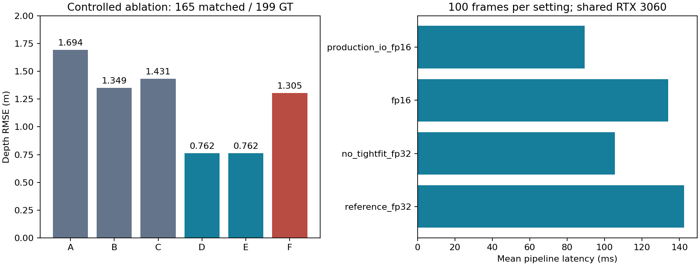

# 決賽實驗與 Demo 更新 — 2026-11-18

> **獨立審閱頁**：[下載含影片的離線預覽包](https://drive.google.com/file/d/1K3ZlBqmFOnGXu4FsNobm9I9f03OeqZHk/view?usp=drivesdk)，解壓開啟 `results/review_preview/index.html`。41,964,267 bytes，內容commit `ea21285`；ZIP、本機SHA256及Drive回讀檔名／大小／資料夾已驗證，遠端checksum未回傳。正式網站未變更。

## 2026-11-18 展示審閱頁

新增results/review_preview/，三分頁：4配置×3指標可切換條圖、8類影片×中英切換、8項補拍建議與4個相機視角概念圖。統計data.js與bilingual_demo/summary.json完全一致，既有影片重用；沒有新增推論或拍攝。待蒐集／合成／實測明確分開。validate_review_preview.cjs驗證來源一致、指標／分頁／情境／相機切換、英文影片播放、離開分頁暫停、手機各頁無橫向溢出。驗證紀錄results/review_preview/validation.json。此為本機離線可用的審閱頁，未改正式網站；等待使用者檢視後再決定整合範圍。


> **中英文大字版已上傳**：[下載42.18MB素材包](https://drive.google.com/file/d/1vmbj7Oe3oZ_O9CdCQ_GumZJSS_IOVH9T/view?usp=drivesdk)（28支影片／離線頁）。內容commit `04960df`，42,182,897 bytes，ZIP、本機SHA256與Drive回讀檔名／大小／資料夾已核對；遠端checksum未提供。播放可離線，重建需完整專案與原始資料。舊版保留。

## 2026-11-18 大字中英文版與朝向機制

- 新增 `results/bilingual_demo/`：原12種素材各中／英文（24支10秒），數值54px、獨立142px標頭；綠虛線GT／紅實線預測，底圖及控制結果不變。另有朝向支撐點／深度偏差兩片各兩語（4支12秒），一次只解釋一個環節。
- 朝向片為明示的長方體幾何示意：固定Z10m、H1.511/W2.128/L4.902m、底部Y1.65m、fy721.5377px，只改yaw0–180°。黃點追蹤投影上下極值，青色車頭標記及角度盤讓旋轉清楚。不是實測轉彎或新模型推論。
- 定義h2D=max(v)-min(v)、h_ideal=fyH/Z、r=h2D/h_ideal、Z_pinhole=Z/r。此例針孔估計約7.05–8.78m，真值固定10m；純示意幅度，不是模型測試成績。原訓練h3D,proj幾何定義仍待建模腳本核實，不把h_ideal冒充已驗證的訓練分母。
- 純旋轉可改變上下支撐點及框高；不能推廣此長方體特定幅度／偏差方向至所有車型、輪廓或姿態。沒有GT比例校正冒充模型效果。詳細定義見 [素材說明](results/bilingual_demo/README.md)。
- 驗證完成：28片完整解碼，實測CSV/JSON與clean版逐byte相同；360個合成角度用獨立解析式驗算，語言切換／播放／手機寬度測試通過。見 `results/bilingual_demo/validation.json` 與 `interaction_validation.json`。
- 重建：`python build_bilingual_demo.py` → `python build_bilingual_catalog.py`；數據與完整解碼驗證：`python validate_bilingual_demo.py`，另有離線頁測試 `node validate_bilingual_page.cjs`。原clean版保留。


> **清爽版雲端已更新**：[下載21.93MB素材包](https://drive.google.com/file/d/1vDXZd7Y4cbov-cxtOhR-fQdA01PjWCUs/view?usp=drivesdk)（12片＋獨立圖表＋離線頁）。內容commit `0b631d2`，21,927,181 bytes；ZIP與本機SHA256、Drive回讀檔名／大小／資料夾已核對，遠端checksum未提供。舊包與分享範圍保留。

## 2026-11-18 清爽版：真實俯視 RGB + 分開比較

- 依最新回饋取代密集解說作為預設入口；舊包保留。12支10秒片＝四設定×前視／俯視＋A/D、F_no_tightfit/F兩組×兩視角。前視上下比較、俯視左右比較，同來源image ID；沒有曲線、長字或片尾卡。綠虛線GT，紅實線預測。
- **真正CARLA俯視影像**：使用每幀 `meta.top_camera` 的內外參，KITTI→CARLA sensor→world→top sensor→pixel。框底面統一放在GT水平面，對應BEV只評XZ的定義；不是車頂輪廓。數字仍取公尺XZ平面IoU，不用像素IoU取代正式結果。
- 全199張影格保留，包括漏檢；30fps／10秒為離線播放，不是推論速度。三處既有metadata重複仍保留，不能宣稱嚴格感測器時間同步。尚無新實際轉角因果影片。
- 數值不變：A深度RMSE1.694m、D0.762m、F1.305m，165配對／199GT、34漏檢／9未配對預測。影片前視顯示幾何中心3D error，與整段深度RMSE明確區分。圖表獨立PNG／CSV／可展開網頁區塊。
- [素材說明](results/clean_demo/README.md)／[驗證](results/clean_demo/validation.json)：12片各300幀完整解碼；所有來源影格／雜湊／摘要通過，IoU與原CSV差0，近垂直相機像素投影IoU與metric IoU最大差7.22e-7（只作幾何核對）。遠／中／近三幀視覺檢查完成。[網頁驗證](results/clean_demo/interaction_validation.json)：離線播放、切方法／視角保留位置、手機無橫向溢出通過。
- 重建：`python build_clean_demo.py` → `python build_clean_catalog.py`；驗證：`python validate_clean_demo.py`、`node validate_clean_page.cjs`。未重新推論、未部署正式網站。


## 2026-11-18 分開解說影片（最新）

[雲端7片解說包](https://drive.google.com/file/d/12tqZDcKPr3Qzl1ICrto0_j_lHEvQsg_c/view?usp=drivesdk)（13,440,768 bytes，內容commit `2d01bdb`）；[上傳收據](results/cloud_upload_2026-11-18_explained.json)。ZIP及本機SHA256、雲端回讀檔名／大小／父資料夾已核對；遠端checksum未回傳。此包獨立新增，不覆寫v2。

- 依使用者回饋，Full F、未補償A、僅Rank-1 D、停用tightfit各自獨立18秒；同199幀、同0–5m深度誤差縱軸、同0–40m BEV。Full在此是完整F管線，不是full矩陣補償變體。
- 框旁以同色引線標Z（相機前向距離）與相機座標ry角度。藍實線＝預測、橘虛線＝GT；另顯示深度／3D中心／朝向角三種不同誤差。
- 中文曲線說明：橫軸影格，縱軸誤差m（yaw專片明標°），白線是當前幀；越低越好，斷線是未配對，不是零。所有影片離線播放，不表示實際fps。
- 新增三支12秒誤差解說：**實際tightfit失敗**（0–30幀；例如13–19幀部分2D更貼而3D中心更差）、**實測朝向誤差觀察**（157–175幀，非因果實驗）、**人工yaw幾何示意**（固定000110 GT尺寸／位置，只旋轉-30°到+30°）。人工片藍框代表人工旋轉，不能當模型輸出；中心固定所以中心誤差為0，但角點位移／BEV IoU改變。
- 尚未找到可核實的實際轉角影片與同次預測／GT，不能宣稱已證明角度轉換造成模型深度誤差。四種配置與tightfit實際片使用11/16既有控制預測，不是新推論。
- [離線素材與說明](results/explained_demo/README.md)、`results/explained_demo/index.html`、[驗證](results/explained_demo/validation.json)：7片完整解碼通過，深度／角差／片段RMSE及人工幾何數值已重算核對。重建 `python build_explained_demo.py`；驗證 `python validate_explained_demo.py`。


## 最新補強｜參考頁與互動 v2（2026-11-18）

- **重新查閱八個參考頁並落實互動**：[A–M對照與來源](docs/DEMO_REFERENCE_REVIEW.md)。6個主影片面板新增點曲線跳幀、來源幀滑桿、方法切換、BEV／可旋轉3D線框。仍為既有幾何框，非稠密重建。
- **另剪6支真正12秒精華版**：固定取完整版3–13秒，再加2秒片段數據卡；各有 `_highlight_per_frame.csv`、`_highlight_summary.json` 與映射。片段RMSE獨立重算，非沿用整段；原12秒整段加速版保留並區分。現在共18支影片。
- **列印及表格**：新增6張3200×520四幀橫排PNG（含四方法BEV版），共60張PNG；可排序A/D/F消融表保留配對與漏檢，仍不製作未核實的跨方法排行榜。
- **驗證**：18支影片完整解碼與CSV摘要驗算通過；離線file:// Chromium互動測試通過，包括影格100定位、片尾、方法／視角切換、排序、前後拖曳與七步切換。[影片驗證](results/demo/validation.json)／[互動驗證](results/demo/interaction_validation.json)。
- 數據與限制不變：原論文165來源、追車視角、多情境、360°原始高度、真實連續序列仍缺。這次新增呈現方式與片段統計，沒有新模型推論，也尚未部署網站。

重建順序：`python build_demo_highlights.py` → `python build_demo_catalog.py` → `python validate_demo_assets.py`；互動測試 `node validate_demo_interactions.cjs`。**v2已上傳**：[下載ZIP](https://drive.google.com/file/d/1Cgbtkw47FfzurnFNdHKa9XPaHhx1RqnX/view?usp=drivesdk)，79,758,680 bytes，內容commit `b199216`。[上傳收據](results/cloud_upload_2026-11-18_demo_v2.json)。ZIP完整性、本機SHA-256與Drive回讀大小／檔名／父資料夾已核對；未取得遠端checksum。保留v1快照與既有分享範圍。

## v1 重點摘要｜Demo 素材（2026-11-18）

- **已製作 12 支影片、54 張 PNG、23 張 JPG**：Teaser、相機視角、四方法查核預覽、補償前後、同次計時，另含 21 張方法步驟圖、分析與失敗案例。[素材入口](results/demo/README.md)／[網站整合 JSON](results/demo/catalog.json)。解壓後開啟 `results/demo/index.html` 即可離線播放、拖曳對照及切換步驟。
- **既有實驗輸出重製成可追溯素材，沒有新推論**：新控制 A→D 深度 RMSE 1.694→0.762m；完整 F 1.305m。逐幀 CSV 保留漏檢與未配對預測；片尾數據只計配對物件，並報漏檢數。
- **計時影片使用同次 100 幀預測**：共享 RTX 3060，均值 89.241ms／11.206fps；這 100 幀深度 RMSE 1.773m（88 配對），不可與 199 幀 F 的 1.305m 混稱。所有影片的 30fps 是離線重取樣播放，不是推論速度。
- **不將未核實資料包裝成完成**：四方法僅查核預覽；缺第三人稱追車、斜側步驟、360°原始高度、多情境與真實連續序列。舊165樣本排行榜仍不可信。三處 metadata 時間／幀號重複，不能宣稱嚴格時間同步。
- **驗證通過**：12 支影片完整解碼（完整版540幀／18s、短版360幀／12s），1080p／H.264／yuv420p／30fps，單檔≤25MB；逐幀映射、摘要重算、成對圖片尺寸及141份素材雜湊通過。[驗證紀錄](results/demo/validation.json)

### 來源與重建

需求版本 `4bf3a08`（最新 DEMO_ASSETS）；推論來源 `dca5aa6` 所記錄之2026-11-16控制結果、對應 timing_production_io 輸出。原始影像／標註／校正／相機metadata／三視角及中間CSV雜湊見 [source_hashes.json](results/demo/source_hashes.json)。相機異常為000091→000092、000094→000095、000097→000098，保留原始順序，沒有刪除或改寫來改善數據。

```bash
/home/e114/anaconda3/envs/mono3d/bin/python build_demo_assets.py
/home/e114/anaconda3/envs/mono3d/bin/python build_demo_catalog.py
/home/e114/anaconda3/envs/mono3d/bin/python validate_demo_assets.py
```

原始來源路徑與模型／權重雜湊在 `results/controlled_20261116/manifest.json`。G-C1 中 sedan 為強制設定；r=1-comp_final/z_est，comp_final單位是公尺，Z_corr與包含tightfit的最終深度分開記錄。G-F1比較A與D，兩者均不含ground/tightfit，不能標成完整F。G-D1只提供既有模型0–180°網格7200筆，不虛構原始高度或另半圈。G-K1的強制SUV不是實際分類器誤判。

**雲端已上傳**：[Demo 素材 ZIP](https://drive.google.com/file/d/1iRgBjb9RdAtCWrnTYF72UfBBu0S2FfvC/view?usp=drivesdk)（68,178,454 bytes，內容 commit `77431e1`）。ZIP 完整性與本機 SHA-256 已驗證；Drive 回讀檔名、大小及父資料夾一致，未回傳遠端 checksum，不能宣稱遠端雜湊驗證。[上傳紀錄](results/cloud_upload_2026-11-18_demo.json)。保留既有分享範圍；未上傳模型權重、完整資料集或本機 PitchLab 附件。未部署網站、未啟用背景自動同步。


## 最新重點摘要｜2026-11-16

- **已跑完15組×199張控制推論**：A–F消融、Rank1/2/3/Full/查表/二次曲面、tightfit與車型／尺寸敏感度。[實驗設計與結果](results/ablation.md)
- **Rank-1有效，但完整流程未必更好**：深度RMSE A 1.694→D 0.762m；完整F 1.305m。10筆tightfit的2D投影改善但3D中心變差，保留逐筆與[案例圖](results/failure_cases/README.md)。
- **速度改善已驗證**：移除未使用的除錯視角讀圖，FP16流程134.017→89.241ms，約33.4%下降；100張預測逐位元一致。[分段計時](results/timing_breakdown.md)
- **舊比較資料混用不同GT**：同ID並非同物件，現存四份pairs不能重現舊165摘要。[查核證據](results/historical_165_audit.md)
- **未全部完成**：原論文同資料／同設定重現、訓練端無洩漏證明、獨佔GPU、坡度／焦距／高度受控捕捉與KITTI連續序列仍缺來源或資源。以下新實驗不能替代這些證據。



依 GEMO3D-finals `d9bf54e6e46bfbad471b0fffaeb7617e9a679e66` 執行。獨立工作目錄 `/home/e114/Desktop/GEMO3D-finals`。既有 AMNet 程式與資料未修改。

## 任務 A｜CARLA 連續序列：完成

- 影片：[GEMO3D_demo_sequence.mp4](results/GEMO3D_demo_sequence.mp4)，1920×1080、H.264、10 FPS、199 張、19.9 秒。
- 資料：`/home/e114/KITTI_ROOT/sed_lincoln_fr_T1R8/data/KITTIDataset_Carla/training`。
- 預測：`/home/e114/eval_kitti/build/results/sed_lincoln_fr_T1R8/SVD/pred/data`，直接重用歷史結果，未重跑此影片的推論。
- 影格：000000–000198，沒有缺號；GT 深度由 35.773440 m 降至 5.157685 m，相鄰最大差 0.179245 m。10 FPS 是展示播放速度，未宣稱為錄製原始 FPS。
- 影片呈現相機 3D 框、GT、鳥瞰圖與深度誤差。
- 命令：`bash results/reproduce_videos.sh`；完整參數保存在該腳本。
- 歷史推論的完整命令、權重版本及原始 pred_meta.csv 未在該輸出目錄找到，不能宣稱與 README 論文設定完全一致。現有預測尺寸約 1.51×2.13×4.90 m，屬 Lincoln sedan；README 範例的 1.52×1.64×3.86 m 不應直接替換為本次結果來源。

| 指標 | 值 |
|---|---:|
| 預測 / GT 車輛數 | 199 / 199 |
| 配對數 | 187 |
| 未配對預測 / GT | 12 / 12 |
| 配對深度 MAE | 0.266660 m |
| 配對深度 RMSE | 0.358734 m |

## 任務 B｜KITTI 真實影像：完成樣本展示，連續序列仍缺

- 影片：[GEMO3D_demo_kitti.mp4](results/GEMO3D_demo_kitti.mp4)，1920×1080、H.264、1 FPS、30 張、30 秒。
- 資料：`/home/e114/KITTI_ROOT/training`；預測：`/home/e114/eval_kitti/build/results/kitti/unknown_hwl/pred/data`。
- 選取排序後前 30 個預測 ID，沒有依誤差挑選；明細見 `results/kitti_demo_frames.txt`。這是 KITTI object detection 非連續影像，影片標題已明確註明，不能充當真實行車連續序列。
- 使用 `unknown_hwl` 既有結果，避開名稱為 `base_gt_hwl` 的 GT 尺寸實驗。完整歷史推論命令及權重版本仍未核實；名稱本身不構成無 GT 輔助的充分證據。保留原始 metadata 中所選影格至 `results/kitti_pred_meta.csv`。

| 指標 | 值 |
|---|---:|
| 預測 / GT 車輛數 | 121 / 99 |
| 配對數 | 75 |
| 未配對預測 / GT | 46 / 24 |
| 配對深度 MAE | 18.672400 m |
| 配對深度 RMSE | 26.542384 m |

誤差顯著，僅能展示流程及失效案例，不能據此宣稱 KITTI 精度或產品化驗證已完成。需有時序對應的 KITTI raw/tracking 資料，並以可追溯設定重新推論，才能完成原要求的連續影片。

## 誤差定義與繪圖修正

按類別相同、2D IoU ≥ 0.5，依 IoU 由高到低做一對一貪婪配對；未配對不計入 MAE/RMSE，並另列數量。這不是 KITTI 官方 AP，也不是論文完整評估。修正原腳本「以 3D 距離 < 3 m 篩選、可重複配對 GT」造成大深度誤差被排除的問題。所有配對均計入統計，畫面最多顯示五列。

另外加入缺圖／缺預測／缺 P2 提前失敗、參數驗證、Linux 字型、字型快取、H.264 編碼、JSON 統計，並讓模組可安全 import 供測試。

## 任務 C｜跳過

使用者明確表示已有，無需處理。本次未生成、放大或替換架構圖。

## 任務 D｜RTX 3060 計時：完成，範圍如下

- 本機 GEMO3D commit：`3dd8e9a404d425ebee8bad40040659ddcdc64757`；PyTorch 2.6.0+cu124；GPU NVIDIA GeForce RTX 3060（12 GB）。GPU 為共享環境，未宣稱獨占或跨硬體可比。
- 100 張：同一 Lincoln CARLA 序列 000000–000099；CLI 指定尺寸 1.511,2.128,4.902 m；2026-11-16 查核發現實際建框被 sedan 映射覆蓋為 1.52,1.64,3.86 m，深度高度參數仍為 1.511 m。YOLO11n、EgoNet、sed_rank_ratio_linear_model.pkl、1280、FP16、投影回饋 3 次、tightfit max_nfev=15 / k=50。完整參數、權重路徑與 SHA-256 見 `results/reproduce_timing.sh`、`results/timing.json`、`results/input_manifest.json`。
- 相同第一張影像暖機 5 次，接著量測 100 張，每張 CUDA synchronize。量測包含讀圖、YOLO、EgoNet、補償、投影修正、tightfit、預測檔寫入；不含模型初始化、calib 讀取、最終 metadata CSV 寫入。另記錄涵蓋上述全部步驟及暖機的整次 wall time。

| 計時範圍 | 結果 |
|---|---:|
| 暖機後單張流程平均 | 153.560426 ms |
| 暖機後單張流程 FPS | 6.512094 |
| 整次 run wall time（含初始化、暖機、校正檔與 metadata I/O） | 27.685918 s |
| 整次 wall time / 100（含額外暖機成本） | 276.859182 ms/張 |
| 整次 100 張 / wall time | 3.611944 FPS |

這是本次實測，不替代論文原 31.12 FPS，也不宣稱參數與原量測完全一致。計時新推論與任務 A 的歷史預測分開保存；計時 metadata 在 `results/timing_pred_meta.csv`。

## 驗證及交付

- 四項單元測試通過：KITTI bottom-center 幾何、GT 不重複配對、較大深度誤差仍保留、類別與 IoU 條件。
- 兩支影片逐張解碼成功（199/199、30/30），並檢視中間影格確認中文字、3D 框、BEV 與數值可讀。預覽見 `results/preview_sequence.jpg`、`results/preview_kitti.jpg`。
- `results/carla_summary.json`、`results/kitti_summary.json` 包含完整影格清單與逐配對深度。
- `results/predictions/` 保存影片使用的預測檔；`results/input_manifest.json` 保存影像、標註、校正、預測及計時權重的來源與 SHA-256。
- 本機回傳包：`/home/e114/Desktop/gemo3d_results_2026-11-15.zip`（results、程式、測試、報告、改善計畫）。原始資料集與模型權重不重複打包。
- 影片均小於 95 MB，依 README 同步 GitHub。依賴：Python、numpy、opencv-python、Pillow、imageio-ffmpeg；Linux Noto CJK 字型。


## 雲端上傳與協作紀錄｜2026-11-15 08:34（Asia/Taipei）

依使用者要求，已將原成果壓縮檔上傳至 Google Drive：

- [成果壓縮檔下載](https://drive.google.com/file/d/1pZv85YbiBR9JTaJ24XN0BopSRfpYNidn/view?usp=drivesdk)
- [GEMO3D-finals 雲端資料夾](https://drive.google.com/drive/folders/1KhSc-MnMtK0IDHQUKcLMGUAKOs2ynonz)
- 檔名：`gemo3d_results_2026-11-15.zip`；大小：8,090,793 bytes。
- 本機 SHA-256：`8057ca05403736d9a26068f0df2306b3a7dce050c899f6859ef21d3f96d3c5b8`。
- 對應成果 commit：`fdec776f629e9d41ac55d1b197cf0eb8817d1d80`。
- 上傳成功後已透過 Drive metadata 回讀核對檔名、大小及父資料夾；連接器未回傳 checksum，未宣稱完成雲端逐位元校驗。下載後可用上述 SHA-256 驗證。
- 權限：私人／擁有者存取。GitHub 上的連結不代表公開下載；其他 AI 需使用已獲授權的 Drive 連線。此次未擴大分享權限。
- 原 ZIP 作為不可變更的實驗快照保留，內含原始實驗報告；本次上傳紀錄與後續協作文件以 GitHub 最新版本為準，不在原 ZIP 內。
- 機器可讀紀錄：`results/cloud_upload_2026-11-15.json`。

新增 `AGENTS.md` 與 `docs/HANDOFF.md`，記錄使用者的持續協作要求：每次實質修改、實驗、雲端交付或狀態變更，完成驗證後同步更新 GitHub 說明與交接，不只在聊天中回報。這是每次工作時的協作規則，不是背景輪詢服務。


## PitchLab 圖表查核與修正｜2026-11-16

確認桌面曲線與 11/15 報告使用不同座標、配對與樣本集合：對向 +10° 舊 GUI 為 6.228128 m（55 筆），新水平座標共同位置統計為 7.274390 m（62 筆）。10 組舊 CSV 與新摘要各自重新加總一致，未將差值解讀為算法精度變化。

本機 GUI 已修正 Matplotlib 中文字體（缺字警告 13 種→0）、補上舊統計來源提示，並將空值顯示為缺值。2 項顯示測試、AST 與 headless 圖形檢查通過；原始資料／歷史報告不改動。使用者實際指出的特定畫面尚待定位，因此僅宣稱已修正上述可重現問題。

完整數值、圖表、修補檔與來源雜湊已保留在研究主機本機查核包。新附件的雲端上傳遭自動審核拒絕（先前授權被判定僅涵蓋原成果包），等待使用者確認；本次 GitHub 僅同步文字摘要，未發布附件。新增 issues #1–#8 已閱讀，摘要見 [issue 檢視紀錄](docs/ISSUE_REVIEW_2026-11-16.md)；未留言、關閉或標記尚未完成的實驗。


## Issue #1／N3 公式實測與 #2 計時前檢查｜2026-11-16

新增 [公式查核](results/formula_check.md)、[全精度與來源 SHA-256](results/formula_check.json)、[三張新推論 metadata](results/formula_pred_meta.csv)、[重跑命令](results/reproduce_formula.sh)、`check_formula.py`。使用 RTX3060 共享 GPU，以既有可追溯模型另跑近10／中20／遠30m；非沿用歷史未核實推論。

- 實際 P2：fy=721.5377px、cy=172.854px，影像1242×375。
- GT 深度10.082185／19.974687／29.957689m；最終深度10.286146／19.976911／29.924770m；僅三個公式示例，不宣稱整體精度。
- 重新插值模型比例並驗證 Zraw=fy×1.511/h2D、Zcorr=Zraw×r=Zraw−comp_final，三筆誤差均小於1e-9。
- 固定模式的深度高度取height_m，不等於pred_h。歷史100張metadata也證實實際建框為sedan預設1.52,1.64,3.86；已更正上述任務D文字，保留原實驗資料。
- 推論端底部中心與幾何中心只差y的h/2，Z相同；建模端訓練腳本未找到，因此issue #1／N3仍有訓練定義待核實，未關閉。
- #2 GPU檢查有CARLA行程，利用率97%，不符合獨佔條件；[計時待辦與環境紀錄](results/timing_breakdown.md)。未量測數據填「—」，未宣稱論文31.12FPS已重現。

驗證：新推論3/3成功；每張1預測、1GT且2D IoU≥0.5；公式assertions通過。未改模型核心、未覆寫舊影片／推論。此次成果屬issue #1指定公開回報；先前PitchLab待核准附件仍未發布或上傳。


## 本次完整執行紀錄｜2026-11-16

**範圍與硬體**：Lincoln CARLA val199張；GEMO3D核心3dd8e9a、RTX3060共享、PyTorch2.6.0+cu124。15組新推論共2985張；四種計時設定各100張，另含暖機與一致性核對。原模型核心／原始資料／舊影片未覆寫。

**結果入口**：

| 工作 | 本次完成 | 尚缺 |
|---|---|---|
| #1 公式 | 三距離實例、P2與metadata一致、PKL自述比例方向 | Blender原始腳本／CSV中心定義 |
| #2 速度 | FP32、no-tightfit、YOLO-FP16、精簡I/O四組分段實測 | 獨佔環境與論文31.12FPS確切命令 |
| #3 消融 | [A–F全指標、全部／共同配對](results/ablation.csv) | 原論文同165物件來源；本次是新序列 |
| #4 補償比較 | [Rank1/2/3、full、查表、二次曲面直接／網格比較](results/compensation_compare.md) | 其他車型與原論文同條件驗證 |
| #5 公平性 | [全部預測計數](results/detection_stats.csv)、[資料切分查核](results/data_split.md)、舊摘要全精度存檔 | 原始訓練清單與baseline完整生成設定，尚不能宣稱無洩漏 |
| #6 穩健性 | [條件盤點與未量測清單](results/robustness_status.md) | 獨立模擬session或新受控資料；PitchLab待核准附件仍未發布 |
| #7 失敗／tightfit／車型 | [15個案例及3組前後圖](results/failure_cases/README.md)、[165筆tightfit比較](results/tightfit_ablation.csv)、[車型敏感度](results/vehtype_sensitivity.csv) | 本次為強制車型干預，不是實際分類錯誤率 |
| #8 圖與KITTI時序 | 架構圖維持使用者指定跳過；本機未找到raw/tracking資料 | 真正連續KITTI序列與校正／時間資訊 |

**重現**：mono3d Python執行 `run_controlled_suite.py`（14組）與 `--variants poly2_direct`（第15組），再執行 `evaluate_controlled_suite.py`、`build_experiment_reports.py`、`summarize_controlled_suite.py`。完整命令見ablation.md；計時命令見timing_breakdown.md。原模型、權重、輸入與輸出雜湊在 [manifest](results/controlled_20261116/manifest.json)，所有方法預測在predictions.json、配對在pairs.csv，不只保留漂亮樣本。

**驗證**：15組的偵測框逐張完全一致；597份輸入雜湊與前次紀錄相同；6項幾何／配對測試通過；計時插樁前後預測一致，精簡I/O版100/100預測TXT逐位元相同；已檢視摘要圖與失敗案例。BEV交集為OpenCV float32幾何，輸出數字保留重算精度但原始TXT本身已四捨五入。

**重要限制**：新控制實驗165配對、新四方法共同20配對與舊論文165配對不相同。歷史baseline使用現存檔案全部候選，分數門檻未核實，不能當公平SOTA排名。獨佔、未知相機泛化、無洩漏及KITTI連續展示均未宣稱完成。所有issue保留未核實部分，不因有CSV就關閉。
